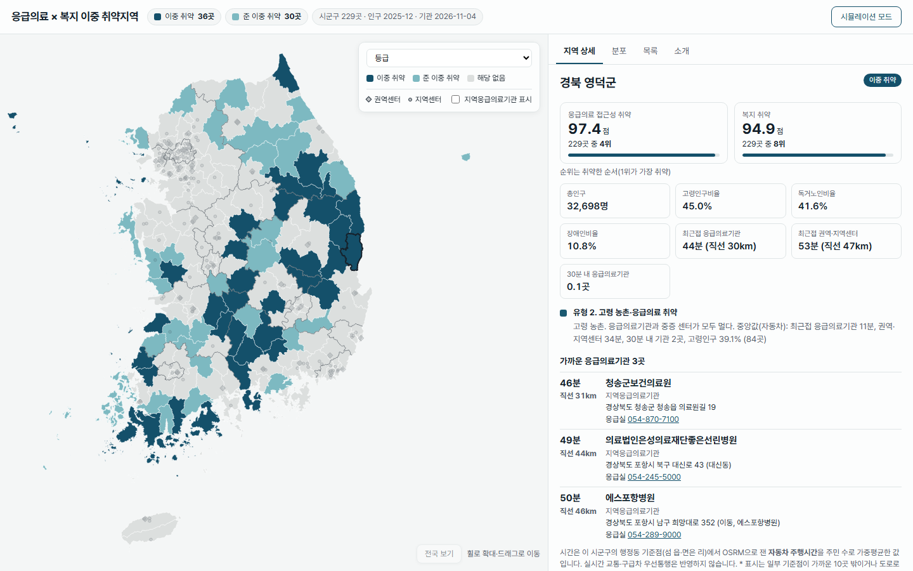
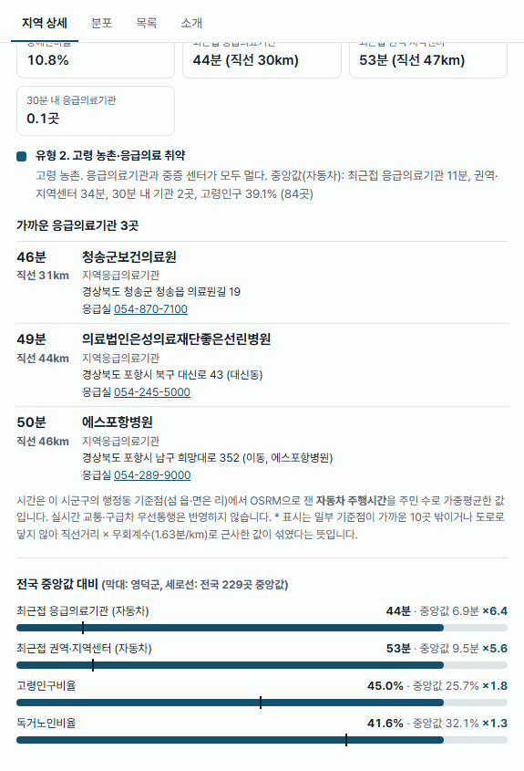
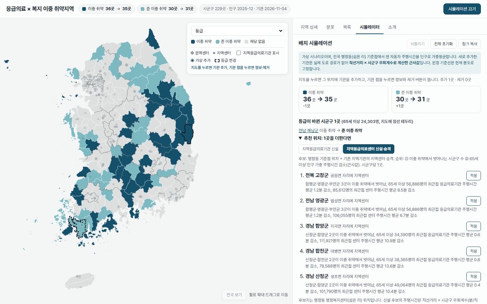
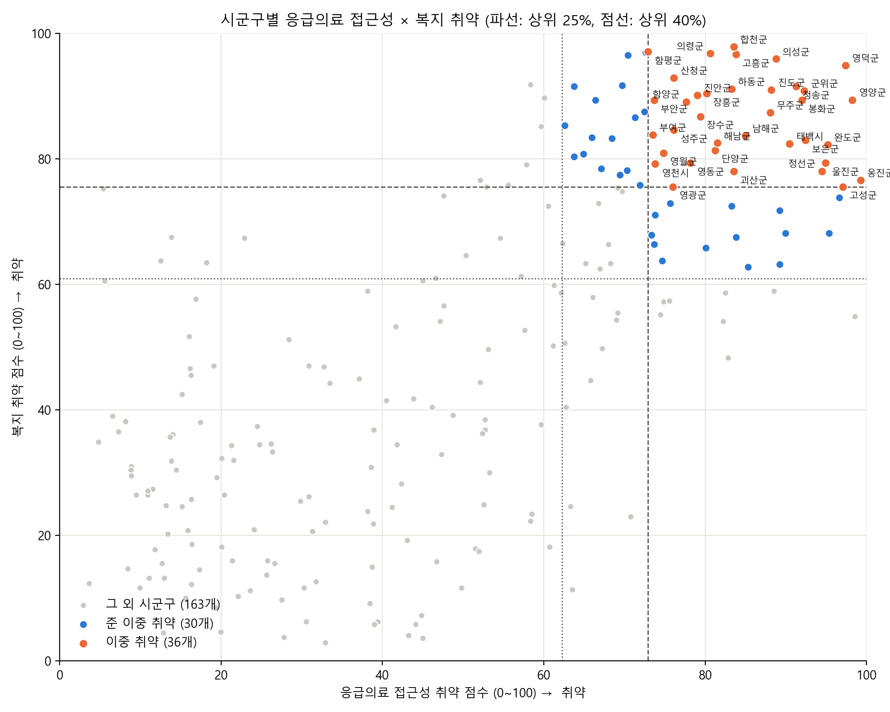
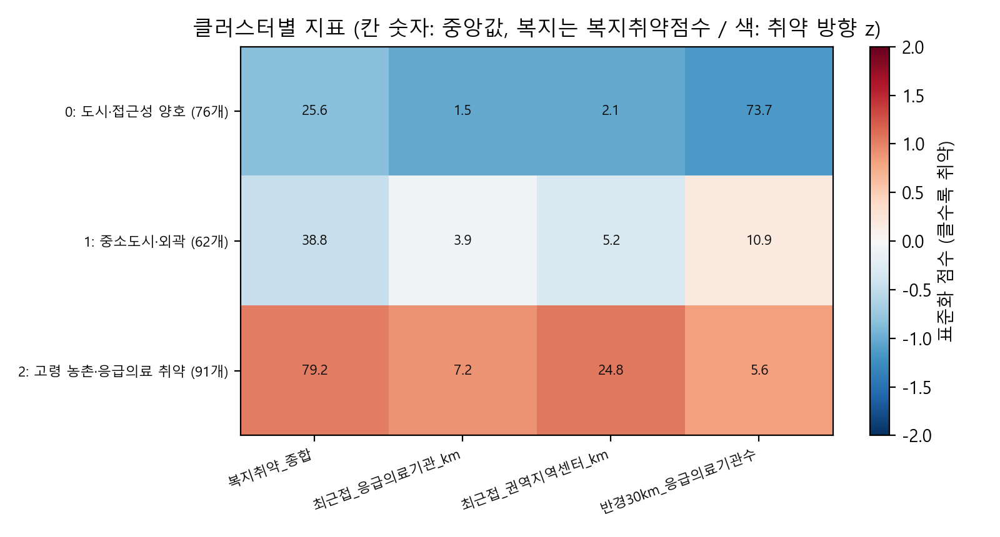

# 응급의료 × 복지 이중 취약지역 (시군구 229곳)

응급실까지 멀고 고령·독거·장애 인구도 많은 시군구를 찾아, 복지 서비스를 먼저 배치할 곳과 응급의료기관 배치 효과를 보여주는 분석·대시보드입니다.

**대시보드: https://gaeun1961.github.io/emergency-policy-clustering-analysis/**



| 지역 상세 (가까운 응급의료기관·주행시간) | 배치 시뮬레이터 (해남 지역센터 추가 예시) |
|---|---|
|  |  |

**핵심 발견**

1. **기준점을 바꾸자 이중 취약이 30곳에서 37곳으로 늘었다.** 시군구청 1점 대신 행정동 3,557곳의 인구가중 기준점을 쓴 결과다. 예전 유형 "고령 농촌·응급센터 원거리"(71곳)는 군청 옆 읍내 응급실 때문에 생긴 착시였다. 지금 이중 취약 36곳 중 센터 원거리형은 0곳이고, 26곳이 응급실·센터가 모두 먼 응급의료 공백형이다.
2. **직선거리를 자동차 주행시간으로 바꿔도 결과는 거의 같다(37→36곳).** 이중 취약 경계를 넘은 곳은 11곳뿐이고(5곳 진입, 6곳 이탈), 모두 준 이중 취약과 자리를 바꿨다.
3. **섬은 근사값이다.** 다리가 없는 섬(기준점 235곳)과 바다 건너 센터까지의 시간은 직선거리 × 우회계수로 근사했고, 배·헬기 이동은 반영하지 않았다. 근사값은 도로 주행시간의 99백분위(126분)에서 잘라 쓴다. 울릉은 주민 100%, 신안 68%, 옹진 61%, 완도 36%가 근사값에 기대고 있어, 이 지역들의 수치는 하한으로 읽어야 한다.

<details>
<summary><b>목차 · 실행 방법 · 상세 결과 펼치기</b></summary>

- [실행 순서](#실행-순서)
- [데이터 갱신 (자동 감지·수동 체크리스트)](#데이터-갱신)
- [핵심 결과](#핵심-결과-시군구-229개-2025년-12월-기준)
  - [주행시간 전환에 따른 결과 변화](#주행시간-전환에-따른-결과-변화-직선거리--자동차-주행시간)
  - [기준점 변경에 따른 결과 변화](#기준점-변경에-따른-결과-변화-시군구청-1점--행정동-인구가중)
  - [Before / After](#before--after)
  - [응급의료기관 배치 시뮬레이터](#응급의료기관-배치-시뮬레이터)
  - [데이터 출처](#데이터-출처)
- [2학년 1학기 시도 단위 분석 (legacy)](#1-프로젝트-개요-및-분석-목표)

## 실행 순서

```bash
python -m pip install -r requirements.txt
cp .env.example .env                       # 키 채우기 (공공데이터포털: DATA_GO_KR_SERVICE_KEY 또는 KR_SERVICE_KEY, 카카오)
# 데이터 수집·통합 (data/README.md 의 raw 파일과 .env 키 필요)
python -m src.population                  # 인구·1인세대 -> 기준 코드표
python -m src.disability                  # 등록장애인
python -m src.fetch_emergency             # 응급의료기관 OpenAPI
python scripts/build_boundaries.py        # 행정동 경계 내려받기·시군구 경계 (node·npx 필요)
python -m src.emd_centers                 # 행정동 기준점: 행정복지센터 좌표 (카카오, 캐시)
python -m src.fetch_emd_population 202512 # 행정동 인구 OpenAPI (기준연월 인자)
python -m src.emd_centers --population 202512  # 행정동 인구 붙이기·검증 (출장소 합산)
python -m src.emd_islands 202512          # 섬 읍·면 리(섬) 좌표·인구
# (WSL, Docker Engine) bash scripts/osrm_setup.sh serve   # 로컬 OSRM: south-korea pbf 전처리 후 localhost:5000
python -m src.drivetime                   # 기준점 × 가까운 기관 자동차 주행시간 (OSRM table API)
python -m src.accessibility               # 접근성 지표 (행정동 인구가중, 주행시간 + 직선거리)
python -m src.build_table                 # 시군구 통합 테이블
python -m src.emd_metrics                 # 읍면동 드릴다운 지표 (행정동별 주행시간·고령 비율·이용 기관)
python scripts/build_emd_boundaries.py    # 행정동 경계를 시군구별 파일로 (web/public/data/emd/, node·npx 필요)
# 분석: 이중 취약지역·클러스터링 -> outputs/
python -m nbconvert --to notebook --execute --inplace notebooks/sigungu_clustering.ipynb
# 대시보드 데이터 -> web/public/data/
python scripts/export_web_data.py
# 대시보드 (web/, node 22)
cd web && npm ci && npm run dev
```

- `scripts/build_boundaries.py`, `src.emd_centers` 는 mapshaper를 `npx` 로 실행하므로 **node(npx)가 필요**하다.
- 기준 시점(주민등록 기준연월 `YM`, 행정동 경계 버전, 장애인 기준연도)은 `src/config.py` 한 곳에서 정한다. 갱신할 때는 이 파일을 고치고 위 순서대로 다시 만든다.
- `src.drivetime` 은 로컬 OSRM 서버가 필요하다. pbf·전처리 파일(약 2GB)은 레포 밖(WSL `~/osrm`)에 둔다. Docker 데몬이 꺼져 있으면 `sudo service docker start`.
- 대시보드는 master에 `web/` 변경이 push되면 `.github/workflows/deploy-pages.yml` 이 빌드해서 GitHub Pages에 배포한다.

## 데이터 갱신

**갱신 주기: 연 1회, 장애인 통계 갱신 후 12월 기준으로 전체 갱신한다.** 등록장애인(KOSIS)은 연 1회(매년 상반기에 전년 연말 기준) 공개되므로, 인구·1인세대·행정동 인구·경계·응급의료기관·주행시간을 모두 같은 12월 기준으로 맞춘다. 기준 시점은 `src/config.py` 에서 바꾼다.

- **202610 갱신 보류 (2026-11-04 결정)**: 2026.7 행정구역 개편(광주·전남 통합, 인천 중구·동구·서구 → 제물포·영종·서해·검단구, 분석 단위 229 → 230)이 반영된 202610 데이터가 나왔지만, 장애인 통계가 아직 2025 연말 기준이라 월 단위로 따로 갱신하지 않았다. 202612 기준 2027 연간 갱신 때 230개 단위로 한꺼번에 반영한다(조사·계획은 이슈 #29). 그때까지 대시보드는 2025-12 기준·229개 단위다.

**자동 감지** (`.github/workflows/data-watch.yml`, 매월 3일 + 수동 실행)
- `scripts/check_data_updates.py` 가 매월 확인하고, 아래 경우에만 `data-watch` 라벨 이슈를 만든다. 같은 제목의 열린 이슈가 있으면 댓글을 단다.
  - **(a) 응급의료기관 변경**: 현재 `web/public/data/facilities.json`(권역·지역센터, 지역응급의료기관)과 비교해 추가·삭제·등급·이름 변경, 50m 이상 좌표 이동. 이슈에는 로컬 OSRM 주행시간 재계산 안내가 붙는다.
  - **(b) 행정구역 개편**: 행정동 인구 API 최신 달의 시도·시군구 수가 그 직전 달과 다를 때 (매월 실행하므로 새로 생긴 개편만 알림. 예: 2026-06 → 2026-07 시도 17 → 16, 시군구 268 → 269)
  - **(c) 연간 갱신 시점**: API 최신 기준월이 사용 중 기준월(`src/config.py` 의 `YM`)보다 12개월 이상 새로울 때
  - 그 밖의 새 기준월(예: 202512 사용 중 202610 공개)은 알리지 않는다.
- 필요한 GitHub Secret은 공공데이터포털 일반 인증키 하나다(두 API 활용신청 필요). 이름은 `DATA_GO_KR_SERVICE_KEY` 또는 `KR_SERVICE_KEY`이고, 둘 다 있으면 앞 이름을 쓴다. 키는 코드·로그에 출력하지 않고, 오류 메시지에서도 지운다.
- 로컬 실행: `python scripts/check_data_updates.py` (`.env` 키 사용, 결과는 `data-watch/`, gitignore). `.env` 는 `.env.example` 을 복사해 만든다(같은 두 이름 중 하나).
- 주행시간(OSRM)은 Actions에서 계산하지 않는다. 이슈를 받으면 로컬에서 [실행 순서](#실행-순서)대로 다시 만든다.

**수동 갱신 체크리스트** (API가 없는 데이터)
- [ ] 인구·1인세대: 행안부 주민등록 인구통계에서 새 기준월 `연령별 인구현황`, `성/연령별 1인세대수` 파일을 받아 `data/raw/population/`, `data/raw/single_household/` 에 넣고 `python -m src.population` (행정동 인구 API 기준월과 맞춘다)
- [ ] 등록장애인: KOSIS DT_11761_N009 새 연도 파일을 `data/raw/disability/` 에 넣고 `python -m src.disability` (매년 상반기 전년 연말 기준 공개)
- [ ] 행정구역 개편이 있으면 `data/region_mapping.csv`, 경계(`scripts/build_boundaries.py` 의 admdongkor 버전)를 먼저 맞춘다
- [ ] 이어서 행정동 기준점·주행시간·접근성·통합 테이블·노트북·웹 데이터를 다시 만들고, README·data/README 의 기준 시점을 바꾼다

## 핵심 결과 (시군구 229개, 2025년 12월 기준)

응급의료 접근성도 낮고 복지 취약계층도 많은 **이중 취약지역**을 찾아, 복지 서비스(예: 응급안전안심서비스) 우선 배치의 근거로 쓴다.
분석 노트북은 [notebooks/sigungu_clustering.ipynb](notebooks/sigungu_clustering.ipynb), 데이터 출처·한계는 [data/README.md](data/README.md)에 있다.

### 이중 취약 36곳 / 준 이중 취약 30곳

- **기준점**: 전국 행정동 3,557곳의 행정복지센터(섬 읍·면 62곳은 리·섬 단위). 기준점별 값을 행정동 인구로 가중평균한다.
- **이동 시간**: 로컬 OSRM(OpenStreetMap, 자동차 프로필, 페리 제외)으로 잰 **자동차 주행시간**. 도로로 닿지 않는 섬 등은 직선거리 × 시군구 우회계수로 대체한다 (아래 "주행시간 전환에 따른 결과 변화").
- **접근성 취약 점수**: 최근접 응급의료기관 주행시간, 최근접 권역·지역응급의료센터 주행시간, 30분 내 응급의료기관 수의 백분위 평균 (0~100)
- **복지 취약 점수**: 고령인구비율, 독거노인비율(65세 이상 1인세대), 장애인비율의 백분위 평균 (0~100)
- **이중 취약**: 두 점수가 모두 상위 25% / **준 이중 취약**: 한쪽 상위 25% + 다른 쪽 상위 40%



| 시도 | 이중 취약 | 시군구 | 준 이중 취약 |
|---|---|---|---|
| 경북 | 8 | 영덕군, 영양군, 의성군, 청송군, 봉화군, 울진군, 성주군, 영천시 | 4 |
| 전남 | 7 | 고흥군, 진도군, 완도군, 장흥군, 함평군, 해남군, 영광군 | 5 |
| 경남 | 6 | 합천군, 의령군, 하동군, 산청군, 남해군, 함양군 | 3 |
| 전북 | 4 | 무주군, 진안군, 장수군, 부안군 | 4 |
| 강원 | 4 | 태백시, 고성군, 정선군, 영월군 | 6 |
| 충북 | 4 | 보은군, 단양군, 괴산군, 영동군 | 0 |
| 대구 | 1 | 군위군 | 0 |
| 인천 | 1 | 옹진군 | 1 |
| 충남 | 1 | 부여군 | 5 |
| 경기 | 0 | | 2 |

전체 목록과 점수·순위·원본 지표는 [outputs/double_vulnerable.csv](outputs/double_vulnerable.csv)에 있다.

- **이중 취약 시군구 안의 읍면동**: 대시보드 지역 상세의 "읍면동 보기"에서 행정동별 접근성 구간(전국 행정동 3,557곳 기준 사분위)을 지도와 목록으로 본다. 이중 취약 36곳의 읍면동 381곳 중 **329곳(주민 70%)이 전국 접근성 하위 25%**다. 영덕·고성(강원) 등 8곳은 모든 읍면동이 하위 25%이고, 옹진은 7곳 중 6곳(백령면만 하위 25~50%)이다. 판정은 시군구 단위 그대로다.
- **이중 취약 지역 안의 유형**: 규칙으로 나눠 보면 "응급의료 공백형"(최근접 응급의료기관·센터 주행시간 모두 상위 25%)이 26곳이다. "센터 원거리형"(응급의료기관은 전국 중앙값 이하, 센터만 상위 25%)은 0곳이고, 나머지 10곳은 응급의료기관 주행시간이 중앙값과 상위 25% 사이다. 이중 취약 지역은 가까운 응급실도 중증 센터도 함께 멀다.

### 시군구 유형 3개 (K-means, K=3)



| # | 유형 | 시군구 수 | 특징 (중앙값) | 이중 / 준 이중 |
|---|---|---|---|---|
| 0 | 도시·접근성 양호 | 86 | 최근접 기관 3.4분, 센터 4.4분, 30분 내 기관 25곳, 고령 20% | 0 / 0 |
| 1 | 중소도시·외곽 | 59 | 최근접 기관 7.1분, 센터 9.5분, 30분 내 기관 6.6곳, 고령 22% | 0 / 0 |
| 2 | 고령 농촌·응급의료 취약 | 84 | **최근접 기관 11.0분, 센터 34.5분**, 30분 내 기관 2.5곳, 고령 39% | 36 / 30 |

**K 선택 근거**

| k | 2 | 3 | 4 |
|---|---|---|---|
| 실루엣 | **0.520** | 0.387 | 0.353 |

K=2가 실루엣 최대지만 도시/농촌 이분만 보여서, 지방 중소도시·도시 외곽이라는 중간 지대를 따로 구분하는 K=3을 골랐다.

### 주행시간 전환에 따른 결과 변화 (직선거리 → 자동차 주행시간)

접근성 지표를 직선거리(km)에서 자동차 주행시간(분)으로 바꿨다. 기준점(행정동 인구가중)과 복지 점수, 판정 규칙은 그대로다. 직선거리 지표는 `data/processed/accessibility_sigungu.csv`에 그대로 남겨 비교한다.

- **계산 방법**
  - 로컬 OSRM(Docker `ghcr.io/project-osrm/osrm-backend`, Geofabrik south-korea 2026-11-03 추출본, car 프로필)의 table API를 쓴다. 페리는 뺐다(`exclude=ferry`).
  - 기준점 4,066곳마다 직선거리로 가까운 응급의료기관 10곳 + 권역·지역센터 10곳만 실제 주행시간을 잰다(약 6.3만 쌍, `data/processed/drivetime_pairs.csv`).
  - 나머지 기관과 도로로 닿지 않는 쌍은 **직선거리 × 시군구 우회계수(분/직선km)**로 근사한다. 우회계수는 기준점마다 도로로 닿는 가장 가까운 기관(직선 1km 이상)의 주행분/직선km를 구해 시군구 중앙값을 쓴다(전국 중앙값 1.74, 1.24~3.09).
  - **도로 스냅**: 기준점이 도로에서 1km 넘게 떨어진 곳은 89곳이고 모두 섬의 리다(독도 88.7km, 가거도 36.5km, 왕등도 29km 등, `data/processed/drivetime_snap.csv`). 이런 점은 다른 섬·육지 도로에 붙어 바다를 건너는 경로가 나오므로 주행시간을 버리고 직선거리 근사로 대체했다. 기관은 1km 넘게 떨어진 곳이 없다.
  - **연륙 안 된 섬**: 어느 기관에도 도로로 닿지 않는 기준점은 235곳이다(옹진 38%, 완도 36%, 신안 34%, 진도 10% 등 23개 시군구).
  - **근사값 상한**(#24): 근사값은 도로로 잰 주행시간(실주행 5.7만여 쌍)의 99백분위 **126.2분**을 넘지 않게 잘라 점수·지도 범례·K-means에 쓴다. 자르기 전 값은 `*_분_원값` 컬럼에 남긴다. 화면에는 "≥ N분 (근사)"로 표시한다.
  - **근사값 반영 배지**: 최근접 응급의료기관이나 센터가 근사값인 주민 비율(`근사반영_인구비율`)이 5% 이상이면 지역 상세에 배지를 단다. 울릉 100%, 신안 68%, 옹진 61%, 완도 36%, 진도 10%, 통영 5%가 해당된다.

| | 직선거리 | 자동차 주행시간 |
|---|---|---|
| 이중 취약 / 준 이중 취약 | 37 / 30 | **36 / 30** |
| 최근접 응급의료기관 전국 중앙값 | 4.1km | 6.9분 |
| 최근접 권역·지역센터 전국 중앙값 | 5.8km | 9.5분 |
| 반경 30km / 30분 내 응급의료기관 수 중앙값 | 11.3곳 | 7.5곳 |
| 접근성 상위 25% 기준선 | 71.6점 | 72.9점 |

- **이중 취약으로 들어온 곳(5, 모두 준 이중에서)**: 단양, 부여, 영천, 성주, 영월
- **이중 취약에서 준 이중으로 내려간 곳(6)**: 금산, 보성, 강진, 상주, 창녕, 임실
- **준 이중**: 강화가 새로 들어오고, 구례·남원은 빠졌다.
- **주행시간/직선거리 비율**
  - 실주행 쌍(직선 1km 이상, 5.7만 쌍)의 도로거리/직선거리 중앙값은 **1.32**, 주행분/직선km 중앙값은 **1.43**이다.
  - 시군구별 "최근접 응급의료기관 주행분 / 직선km" 중앙값은 **1.75**(센터 1.61)다.
  - 도심은 신호·저속 구간 때문에 직선 1km당 시간이 길고(부산 서구 3.1, 서울 강동구 2.9), 국도가 곧은 농촌은 짧다(음성 1.20, 창녕 1.22).
  - 이중에서 내려간 6곳은 최근접 센터까지 주행분/직선km가 1.08~1.30으로 전국 중앙값(1.61)보다 낮다. 곧은 국도·고속도로로 센터에 닿기 때문이다.
  - 들어온 곳 중 단양(2.02)·영월(1.77)은 길이 돌아가는 산악 지형이다. 영천·성주·부여는 비율이 중앙값 근처지만, 기준선 바로 아래 있다가 다른 지역 순위가 내려가면서 넘어왔다.
- **클러스터**: 3개 유형은 그대로이고 크기만 76/62/91 → 86/59/84로 바뀌었다(이동 19곳, 모두 인접 유형 사이).

### 섬 근사값 상한 처리 전후 (#24)

도로로 닿지 않는 쌍의 근사값(직선거리 × 우회계수)이 그대로 들어가, 울릉 센터 365분처럼 바다를 건너는 값이 지도 범례와 K-means 표준화를 끌고 있었다. 근사값을 도로 주행시간의 99백분위(126.2분)에서 잘랐다.

| | 직선거리 | 주행시간 (상한 전) | 주행시간 (상한 후) |
|---|---|---|---|
| 이중 취약 / 준 이중 취약 | 37 / 30 | 36 / 30 | **36 / 30** (등급 바뀐 곳 없음) |
| 클러스터 (0 / 1 / 2) | 76 / 62 / 91 | 86 / 59 / 84 | **86 / 59 / 84** (이동 없음) |
| K=2·3·4 실루엣 | | 0.519 · 0.384 · 0.355 | 0.520 · 0.387 · 0.353 |
| 인천 옹진군 접근성 순위 (점수) | 13위 (89.8) | 1위 (99.4) | **1위 (99.3)** |
| 경북 울릉군 | 34위 (80.9) | 25위 (84.7) | **25위 (83.8)** |
| 전남 신안군 | 7위 (94.2) | 5위 (97.1) | **6위 (96.7)** |
| 전남 완도군 | 6위 (94.9) | 8위 (95.1) | **8위 (95.2)** |

- 상한에 걸린 시군구는 7곳이다. 울릉 센터 365→126분, 옹진 센터 143→83분, 신안 센터 68→62분·응급의료기관 38.8→38.1분, 완도·진도·통영·여수는 0.1분 안팎이다.
- **점수·등급이 거의 그대로인 이유**: 접근성 점수는 값의 크기가 아니라 백분위 순위를 쓴다. 울릉은 상한 후에도 센터 시간 1위이고, 옹진은 2위에서 3위(완도 다음)로 한 칸 내려갔을 뿐이다. 왜곡이 컸던 곳은 표시값(범례 최댓값 366분 → 126분, 지역 상세)과 K-means 입력이었는데, K-means 입력은 log1p 변환을 거쳐 이상치 영향이 이미 작았기 때문에 클러스터 배정은 바뀌지 않았다.
- **옹진 1위는 상한과 무관**: 옹진은 주민 61%가 근사값을 쓰지만, 최근접 응급의료기관 46.6분은 상한(126분) 아래라 그대로다. 직선거리 13위에서 1위로 오른 것은 섬 기준점이 근사값(직선 × 옹진 우회계수 1.80)을 쓰기 때문이고, 해상 이동을 반영하면 더 나빠질 값이다.

### 기준점 변경에 따른 결과 변화 (시군구청 1점 → 행정동 인구가중)

(직선거리 기준일 때 기록)

처음에는 시군구청 한 곳(섬 3개 군만 읍면 인구가중)에서 거리를 쟀다. 지금은 시군구 안 모든 행정동 주민의 거리를 인구로 가중평균한다.

| | 시군구청 1점 | 행정동 인구가중 |
|---|---|---|
| 기준점 | 시군구청 229곳(섬 3개 군은 읍면사무소) | 행정동 행정복지센터 3,557곳 (섬 읍·면 62곳은 리·섬 단위) |
| 이중 취약 / 준 이중 취약 | 30 / 29 | **37 / 30** |
| 최근접 응급의료기관 거리 전국 중앙값 | 1.1km | **4.1km** |
| 최근접 권역·지역센터 거리 전국 중앙값 | 3.6km | 5.8km |
| 접근성 상위 25% 기준선 | 64.9점 | 71.6점 |

- **이중 취약으로 들어온 곳(12)**: 괴산, 장흥, 영광, 상주, 의령, 창녕, 남해, 함양, 합천, 진안, 임실, 부안
- **이중 취약에서 준 이중으로 내려간 곳(5)**: 서천, 구례, 영천, 성주, 정읍
- **청사 옆 병원 과소추정 해소**: 군청 바로 옆에 병원이 있어 최근접 거리가 0.1km 안팎으로 나오던 곳이, 군 전체 주민 기준으로 바뀌었다. 거창 0.07→3.4km, 단양 0.10→5.4km, 화천 0.15→7.3km, 괴산 0.21→9.1km, 합천 0.23→8.4km.
- **시청과 인구 중심 불일치 해소**: 화성은 시청이 인구 밀집지(동탄 등)에서 멀리 있어 10.3km로 과대 추정됐는데, 4.0km로 내려갔다.
- **기존 클러스터 구분이 사라짐**: 예전 K=3에는 "고령 농촌·응급센터 원거리(읍내 응급실은 있으나 센터 원거리)"와 "고령 농촌·응급의료 취약(가까운 응급실 자체가 없음)"이 따로 있었다. 이 구분은 군청 기준점 때문에 생긴 것이었다. 군청 옆에 읍내 응급실이 있으면 최근접 거리가 아주 짧게 나왔기 때문이다. 군 전체 주민 기준으로 보면 두 묶음이 하나("고령 농촌·응급의료 취약" 91곳)로 합쳐지고, 대신 지방 중소도시·외곽이 따로 나뉜다.

### Before / After

| | 2학년 1학기 버전 (legacy/) | 현재 |
|---|---|---|
| 분석 단위 | 시도 17개 | 시군구 229개 (일반구는 상위 시로 합산) |
| 변수 | 2개 (인구, 응급의료기관 수) | 복지 3개 + 접근성 3개 (인구 대비 비율, 거리) |
| 데이터 수집 | 엑셀 파일 직접 다운로드 | 행안부·KOSIS 파일 + 응급의료기관·행정동 인구 OpenAPI + 카카오 로컬 API + OpenStreetMap 도로망(로컬 OSRM) |
| 접근성 | 인구 10만 명당 기관 수 | 행정동 3,557곳 기준 최근접 기관·센터 **자동차 주행시간(OSRM)**과 30분 내 기관 수를 인구가중 |
| 섬 지역 | 구분 없음 | 면사무소와 다른 섬에 사람이 사는 읍·면 62곳은 리(섬)별 좌표·인구로 가중 |
| k 선정 | K=3 고정 | 엘보우·실루엣 비교 후 K=3 (실루엣 0.387, 해석 가능성 기준) |
| 결과물 | 시도 유형 3개 | 이중 취약 36곳·준 이중 취약 30곳 + 시군구 유형 3개 + 배치 시뮬레이터 |

### 응급의료기관 배치 시뮬레이터

대시보드에서 **시뮬레이션 모드**를 켜면, 지도에서 응급의료기관을 실제 위치에 추가하거나 기존 기관을 제거할 수 있다. 그러면 시군구 접근성과 이중 취약 등급이 어떻게 바뀌는지 바로 보여준다. 2학년 버전은 지역별 기관 "개수"를 바꾸는 방식이었고, 이번 버전은 "위치"를 바꾼다.

- **사용법**
  - 지도를 누르면 그 위치에 기관을 추가한다(지역기관 / 지역센터 / 권역센터 중 선택). 시군구 경계 안(육지·섬)만 추가할 수 있다.
  - 기존 기관 점을 누르면 제거한다.
  - 되돌리기, 전체 초기화를 지원한다.
  - 시나리오(추가한 좌표·등급, 제거한 hpid)는 URL 쿼리에 저장된다. 예: `?sim=1&add=G006:34.57391,126.59964&rm=A1200028`. 링크를 공유하면 같은 시나리오가 열린다.
- **결과 패널**: 이중·준 이중 취약 수 변화, 등급이 바뀐 시군구 목록과 그 지역의 65세 이상 인구 합계를 보여준다. 등급이 바뀐 시군구는 지도에 점선 테두리로 표시한다.
- **추천 위치**: "1곳을 더한다면 어디가 가장 효과적인가"
  - 후보: 행정동 기준점(행정복지센터, 섬은 리) 약 4,000곳에 지역기관 또는 지역센터를 신설하는 경우와, 기존 지역기관을 지역센터로 승격하는 경우
  - 순위: ① 이중 취약에서 벗어나는 시군구 수, ② 65세 이상 인구 가중 주행시간 감소량(최근접 응급의료기관 + 최근접 센터, 인·분)
  - 새로 놓는 기관은 실제 도로 경로가 없어 **직선거리 × 그 시군구 우회계수로 근사**하고, 화면에 "근사값"이라고 표시한다. 승격 후보는 기존 기관의 실주행시간을 쓴다.
  - 비슷한 후보가 목록을 채우지 않도록 시군구당 1곳만 보여준다. 각 후보에는 "왜 이 위치인가"를 한 줄로 붙이고, 누르면 그 시나리오를 바로 적용한다.
  - 계산은 Web Worker에서 한다. 영향 범위 밖 기준점을 먼저 걸러 종류별 1.5~2초 걸리고, 그동안 화면은 멈추지 않는다.
- **계산**
  - 브라우저에서 Python(`src/accessibility.py`, 노트북)과 같은 정의로 다시 계산한다. 백엔드는 없다.
  - 수정 없는 상태에서 229곳의 지표·점수·등급이 Python 결과와 정확히 같은지 vitest로 검증한다(`cd web && npm test`).
  - 데이터: `web/public/data/facilities.json`(응급의료기관 416곳), `centers.json`(행정동·리 기준점 4,066개, 인구 가중치, 가까운 기관 실주행시간), `baseline.json`(baseline 분포·기준선·시군구 우회계수)
- **기준선 고정**
  - 시뮬레이션에서는 지표 값을 "현재(baseline) 분포 기준 백분위"로 환산하고, 판정 기준선(상위 25%: 접근성 72.93 / 복지 75.55, 상위 40%: 62.27 / 60.90)도 고정한다.
  - 백분위를 다시 매기면 한 지역이 좋아질 때 다른 지역의 순위가 밀려서, 아무것도 바뀌지 않은 지역이 이중 취약이 되는 왜곡이 생기기 때문이다.
  - 복지 점수는 시뮬레이션 대상이 아니라 고정이다.
- **가까운 기관 목록** (지역 상세·읍면동 보기)
  - 주민 평균 자동차 주행시간이 짧은 순으로 응급의료기관 3곳, 권역·지역센터 2곳을 보여주고, **이용 주민 비율 10% 이상인 기관은 순위 밖이어도 항상 넣는다**(합계 최대 5곳, 목록은 주행시간 순). 읍면동 보기도 같은 규칙이다. 시군구 밖 기관도 포함하고, 지도에 테두리로 강조한다.
  - 시간은 두 가지다. **전체 주민 평균**(순서를 정하는 값)과, 그 기관이 가장 가까운 주민만의 **이용 주민 기준 평균**이다(지역 상세·읍면동 보기·기관 팝업). 예: 영덕 울진군의료원은 전체 평균 88분이지만 이용 주민(29.9%) 기준은 53분이다.
  - 각 기관에 "그 기관이 가장 가까운 주민 비율"을 붙인다. 0%인 기관은 **대안**으로 흐리게 보이고 1위보다 몇 분 더 걸리는지(+N분) 적는다.
  - 평균은 시군구 전체 주민 기준이라, 일부 주민에게만 가장 가까운 기관은 평균 순위가 낮다. 예: 영덕 북부 주민 30%의 최근접인 울진군의료원은 남부 주민까지 넣은 평균으로는 11위(88분)지만, 이용 10% 이상 규칙으로 4번째에 들어간다.
- **읍면동 보기**
  - 선택한 시군구의 행정동을 전국 행정동 기준 접근성 구간으로 색칠하고, 인구·고령 비율·최근접 응급의료기관·센터 주행시간·가까운 기관을 목록으로 보여준다. 섬 읍·면은 리별 값을 펼쳐 볼 수 있다.
  - 지역 상세는 **개요 / 이용 기관 / 읍면동 보기** 탭으로 나뉘고, 지역을 바꿔도 마지막 탭이 유지된다. 이용 기관 강조 링은 '이용 기관' 탭에서만 보인다.
  - 읍면동 보기에서 시군구를 고르면 그 범위로 확대하고, 최대 배율을 시군구 크기에 맞춰(화면에 맞춘 배율의 3배, 기본 최대 14배보다 크면) 올려 작은 구도 동이 구분된다. 면이 충분히 크게 보이면 읍면동 이름표를 단다. 탭을 오가도 줌·위치는 그대로다.
  - 경계는 시군구별 파일(229개, 합계 6.6MB, 파일당 중앙값 30KB)로 나눠 고를 때만 불러온다. 시뮬레이션 중에는 추가·제거한 기관이 반영된다.
- **한계**
  - 주행시간은 OSM 도로망의 자유 주행 기준이다. 실시간 교통(정체·시간대), 구급차 우선통행·신호 무시는 반영하지 않는다.
  - 연륙 안 된 섬은 해상 이동(배·헬기 운항 시간, 기상)을 반영하지 못하고 직선거리 × 우회계수로 근사한다. 근사값은 126분에서 잘라 "≥ N분 (근사)"로 보이므로 실제 시간의 하한이다. 울릉 센터는 자르기 전 365분이었다.
  - 병상·인력 같은 수용력은 반영하지 않는다.
  - 읍면동 보기에는 접근성과 고령 비율만 있다. 독거노인·장애인 비율은 읍면동 단위 공개 통계가 없어 시군구 값만 쓴다. 고령 비율은 행정동 인구 API가 10세 단위라, 60대를 시군구의 65~69세 비율로 나눈 추정치다(행정동 합 = 시군구 65세 이상 인구). 인구 500명 미만 행정동(3곳)은 비율이 불안정하다고 표시한다.
  - 기준점은 행정동 행정복지센터 한 점이라, 넓은 읍·면 안 마을별 거리 차이는 남는다(섬 읍·면은 리 단위).
  - 추천 후보지는 행정동 기준점 위치와 기존 지역기관으로 한정된다. 실제 부지 여건은 고려하지 않는다.
  - 가상 시나리오이므로 정책 결정의 참고용으로만 쓴다.
  - (해소됨) 예전에는 후보지와 측정점이 같은 시군구청이라 추천이 시군구청 위치에 유리했고, 시군구청에서 떨어진 곳의 효과가 과소평가됐다. 행정동 인구가중으로 바꾸면서 해소됐다.

### 데이터 출처

- 인구·1인세대: 행정안전부 주민등록 인구통계 (2025년 12월)
- 행정동·리 인구: 행정안전부_법정동별(행정동 통반단위) 성/연령별 주민등록 인구수 OpenAPI (공공데이터포털 15108074, 2025년 12월)
- 등록장애인: 보건복지부 장애인현황, KOSIS DT_11761_N009 (2025년 연말)
- 응급의료기관: 국립중앙의료원 응급의료정보조회 서비스 OpenAPI (공공데이터포털, 2026-11-04 수집)
- 행정동 기준점(행정복지센터)·리 좌표: 카카오 로컬 API
- 도로망·주행시간: © [OpenStreetMap](https://www.openstreetmap.org/copyright) contributors ([ODbL](https://opendatacommons.org/licenses/odbl/)), Geofabrik south-korea 추출본(2026-11-03), [OSRM](https://project-osrm.org) 자동차 프로필로 계산
- 지도 경계: [vuski/admdongkor](https://github.com/vuski/admdongkor) ver20251231 행정동 경계 (CC BY 4.0). 원자료는 통계청 [SGIS](https://sgis.kostat.go.kr) 행정구역 경계다. 시군구로 합치고 단순화해서 사용했다.

자세한 출처, 받는 방법, 데이터 한계는 [data/README.md](data/README.md)에 있다.

---

> 아래는 2학년 1학기 시도 단위 분석(legacy/)의 설명이다.


## 1. 프로젝트 개요 및 분석 목표

### 프로젝트 명: AI/ML 기반 지역별 응급 의료 취약성 유형화 연구


본 프로젝트는 기존의 단순 통계 보고서의 한계를 극복하고, AI/ML (K-Means 군집 분석)을 활용하여 대한민국 17개 시도의 구조적 응급 의료 취약성 유형을 명확히 분류하는 것을 목표로 한다.


### 핵심 성과

데이터 전처리 및 다차원 클러스터링 분석을 통해, 획일적인 정책 적용이 불가능한 3가지 고유한 지역 유형을 도출하고 정책적 근거를 제시한다.

* 데이터 전처리 활동을 통해 인구/응급기관 데이터를 통합하고 5가지 핵심 지표를 구축하여 AI/ML 모델의 입력 데이터(Features)를 확보.

* AI/ML 분석 활동을 통해 K-Means 클러스터링 및 PCA를 수행하여 지역별 맞춤 정책 수립의 근거가 되는 유형을 도출.


---------------------

## 2. 핵심 분석 과정 및 방법론

### 가. 데이터 전처리 및 특성 공학 (Feature Engineering)

프로젝트의 첫 단계는 이종 데이터의 정확한 통합 및 분석 지표 구축한다.

* 데이터 통합 및 정규화: 인구 데이터에서 총인구 및 고령화율 지표를 산출했으며, 기관 데이터는 시도명 불일치 문제를 해결하고 컬럼을 정규화. 최종적으로 이 두 데이터를 통합하여 인구 10만 명당 4가지 기관 접근성 지표 (권역센터, 지역센터, 지역기관, 응급시설)을 계산.

* AI/ML 입력 데이터 확정: 클러스터링의 입력 변수로 고령화율과 4가지 인구 10만 명당 접근성 지표를 확정하여 총 5가지 다차원 벡터를 구성.


### 나. K-Means 군집 분석 (AI/ML Core Activity)

수행된 K-Means 클러스터링 분석은 다음의 논리로 진행되어 3가지 유형을 도출한다.

* 데이터 표준화: 5가지 지표 간의 척도 차이를 제거하기 위해 StandardScaler를 사용하여 데이터를 표준화.

* K-Means 실행: K=3으로 설정하여 17개 시도를 유형화.

* 결과 해석: 히트맵 분석을 통해 클러스터별 특징을 통계적으로 입증했으며, PCA 시각화를 통해 5차원 분석 결과가 2차원 평면상에서 명확히 구분됨을 확인.


-----------------------

## 3. 분석 결과 및 정책적 함의

### 가. 지역별 구조적 취약성 유형 도출

분석 결과, 17개 시도는 다음 3가지 고유한 유형으로 구분되어 획일적인 정책의 한계를 명확히 보여준다.

1. Cluster A: 고령/시설중심형: 고령화 압력이 최우선 해결 과제이며, 자원 효율화 정책이 필요.

2. Cluster C: 대도시/인구과밀형: 인구 과밀로 인한 자원 절대 부족이 문제이며, 상위 응급센터 확충이 시급.

3. Cluster B: 중위/균형형: 모든 지표에서 중간 수준을 유지하며, 현 시스템 유지 및 지역별 격차 해소에 집중 필요.


### 나. 향후 AI 기반 시스템 확장 논리

본 분석 결과는 향후 AI 시스템 구축의 핵심 근거가 됨

* AI 정책 시뮬레이터 설계 근거: K-Means분석으로 도출된 클러스터 중심점(Centroids)은 각 지역 유형의 최적 정책 목표를 수치적으로 정의하는 기준점이 된다. 시뮬레이터는 이 중심점을 기준으로 정책 효과를 예측하게 된다.

* AI 챗봇 설계 근거: 챗봇은 이 3가지 유형의 특징을 기반으로, 정책 결정자에게 구체적인 자원 배분 목표를, 일반 국민에게 실생활 응급 대비책을 맞춤형으로 제공하는 논리적 기반을 확보한다.

</details>
